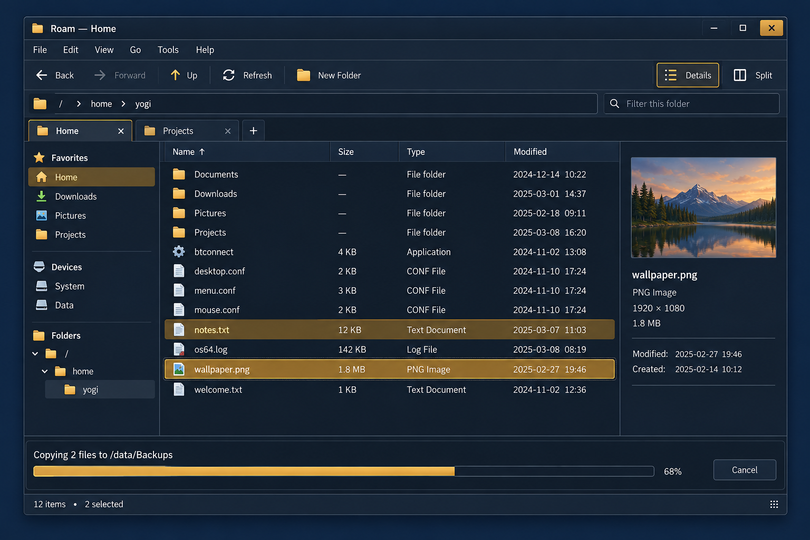
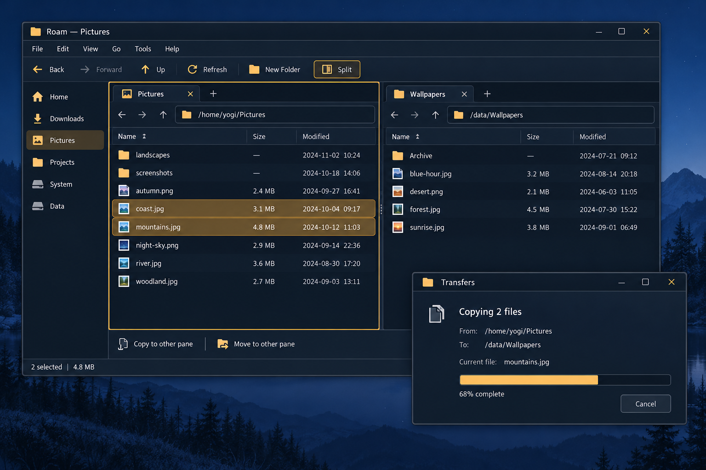
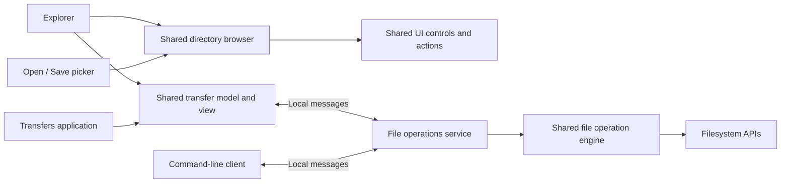

# File Explorer — design and delivery plan

Status: umbrella design, updated 2026-10-13. E1 and E2 are merged; E3 has a
ready implementation design. The tracker below owns detailed acceptance status.
Original inspected baseline: `userland` at `f3f5f50e`; E1/E2 inspection refreshed
against `6d988565` in their linked slice designs.
**Roam** is the application name, confirmed by Chris on 2026-10-11.

**Resuming this project? Start with the [project tracker](explorer/README.md).**
It links current status, decisions, session history and the next handoff. This
document owns product scope and architecture; progress belongs in the tracker.

Build a native, keyboard-friendly file explorer with Details as its default
view, tabs, optional split panes, and independent file transfers. Build the
controls and useful higher-level components as shared facilities, so the
next application does not have to build them again.

This document records the requested product, selects an engineering direction,
and defines delivery slices. It does not freeze every menu label or introduce
a kernel ABI. Slice designs settle those contracts before their implementation.
Quinn owns sequencing, integration and verification; Chris reviews the visible
behavior at the checkpoints below. Routine engineering choices need not become
customer decisions.

## 1. Product shape

The everyday layout is a menu bar, navigation toolbar and address bar above a
folder view, with an optional sidebar and preview panel. A status bar reports
selection and folder information. A transfer shelf can appear below the view;
the same jobs can also be followed in a separate Transfers application.

### Independently hideable interface

Chris's requirement (2026-10-11): each surrounding interface component is
independently toggleable from the menu, including the menu bar itself. This
covers navigation tools, the address/breadcrumb bar, sidebar/tree, preview,
status bar, transfer shelf, tab strips, filter/search controls and the second
directory pane as those components arrive. The remaining directory view fills
the released space. Support both a bare directory browser and a browser with
only its address bar and menu bar visible; Xfe's simple layout is a reference.
The directory view remains the usable core; window decorations follow the
existing desktop appearance policy.

Hiding a component changes presentation, not ownership: it must not discard
tab/pane locations or cancel accepted transfers. Detailed designs must address
focus leaving a hidden control, access to hidden tabs, and active filters or
errors whose normal presentation is hidden. Visibility is a shared action state
so menu checkmarks and the actual layout agree.

E1 must provide the recovery interaction accepted by Chris on 2026-10-11:
Alt or F10 temporarily reveals the hidden menu;
Escape restores the hidden layout, and a directory context-menu command can
restore the menu persistently. Modifier/key routing, visibility persistence and
per-window versus per-pane scope belong in the slice designs. Acceptance must
exercise both minimal layouts and restoration using keyboard and pointer.

These generated concept images establish layout and atmosphere, not pixel
specifications. Their sample files, counts, metadata and controls are
illustrative. In particular, a Created field in an image is not evidence that
the filesystem exposes creation time. Appearance and frame composition come
from the user's settings; the pictured colors are one possible appearance.

### Browsing and selection

- Start in Details view: Name, Size, Type and Modified. Show extensions.
  Sort folders first independently of sort direction. Columns can resize,
  reorder and hide; Name remains available. Type is a presentation label from
  directory/file kind and known extensions, not a claim of content inspection.
- Support keyboard navigation, incremental type-to-select, Ctrl+click,
  Shift+click, Ctrl+A, Enter to open, and F2 to rename. Rename selects the
  basename of a normal filename; extension and dotfile rules belong in its
  interaction design. Focus, selection and the range anchor are distinct.
- Back, Forward, Up and Refresh have toolbar and keyboard actions. Breadcrumbs
  become an editable path with Ctrl+L; completion lists directories. Preserve
  scroll and selection where entries can still be matched.
- The sidebar offers favorites, mounted volumes and an expandable directory
  tree. It is resizable and hideable. Expanding a tree node reads that node,
  not its entire subtree. Favorites can be reordered.
- A quick filter narrows the current directory. It is visibly distinct from
  type-to-select and from a recursive Search command. Hidden-file visibility
  is a setting; the initial convention is leading-dot names.
- Tabs retain their own location, history, view, filter and selection. Ctrl+T,
  Ctrl+W and middle-click on a folder are supported. Split view contains two
  independent tab groups, with an obvious active pane. Commands target that
  pane; Copy/Move to Other Pane shows the actual destination before submission.
- Add compact list, icons and thumbnails after the Details workflow works.
  Changing view retains the model and selection. Optional selection checkboxes,
  single-click opening, density and session restoration follow as preferences.

### Actions and information

Use a traditional menu bar: File, Edit, View, Go, Tools and Help. Exact grouping
is a slice-design decision. A shared action model supplies labels, shortcuts,
enabled/checked state and help text to menus, toolbars and context menus.
Status-bar help follows the highlighted action without replacing persistent
job/error state. Menus and the status bar ship together, but remain separate
controls that can be used independently.

Right-click menus use a reusable toolkit popup-menu widget, shared with menu-bar
dropdowns and cascades. Adapt `grootmenu` to this widget as a real E1 consumer;
keep its configuration parser and process-launch policy outside the widget.
Menus follow the configured Interface font for both measurement and painting,
including font changes while open. The inspected `grootmenu` currently paints
its own rows with the fixed bitmap text renderer; `os64/menu.h` shares only the
configuration grammar, not a menu widget. Its private presentation must be
replaced rather than becoming a second menu implementation.

Chris selected native popups that extend beyond their owner window. The
focused [E1K GUI prerequisite](explorer/GUI_POPUPS.md) adopts Fable's smaller
owned-window architecture after [review disposition](explorer/GUI_POPUPS_DISPOSITION.md).
Fable's second review closes the focus/input questions; the concrete
[E1K handoff](explorer/E01K_HANDOFF.md) now governs implementation and validation.
[E1's userland contract](explorer/E01_MENUS.md) consumes it; menu controllers,
placement and rendering stay in userland.

Opening a file uses a shared association/launch facility; Open With offers an
explicit choice. Also provide Open Terminal Here and Copy Full Path. Pass paths
as arguments, never by interpolating filenames into shell command text.

The optional preview shows bounded text, supported images and available
metadata. Directory size is an explicit, cancellable calculation. File sizes
and selected-byte totals do not quietly include recursively measured folders.
Unknown times are blank or marked unknown, not rendered as January 1970.

### Transfers and destructive actions

Copy, move and later deletion are jobs with visible per-item outcomes. The
explorer submits work to another process. Closing a tab, a browser window or a
progress window does not cancel an accepted job. Cancel is an explicit action.

Show the current item, bytes/files completed, destination, and errors. Discovery
may have an unknown total; show that honestly. Offer Replace, Skip and Keep Both
for conflicts where supported, with an explicit scope for “apply to remaining.”
Pause, reboot recovery and resumable partial copies are separate features.

Trash and Undo require their own design. Before Trash exists, label removal
**Delete permanently**, require confirmation, and make the lack of recovery
clear in that confirmation. Undo is enabled only for operations with a recorded,
still-valid inverse; it must not suggest that overwriting data is recoverable.

## 2. What already exists, and what must be built

Paths below are relative to the repository root and describe the inspected
baseline, not guarantees about a later revision.

| Existing facility | What it buys us / remaining work |
| --- | --- |
| `userland/libos64/include/os64/ui.h` | Buttons, fields, scrollbars and a single-selection listbox; a multi-selection data view, menus, tabs, tree and split container need shared implementations. Preserve existing listbox consumers. |
| `userland/libos64/include/os64/menu.h`, `userland/apps/grootmenu/grootmenu.c` | Shared launcher configuration grammar and desktop menu behavior to study/reuse; not an application menu-bar/action API. Keep configuration parsing separate from menu presentation. |
| `userland/libos64/include/os64/work.h` | Bounded background jobs, cancellation and completion doorbells for a window. Reuse for directory reads/previews where suitable; not a cross-process transfer service. |
| `abi/include/os64/dirent.h` | Name, size, directory/mount flags and modification time in each entry. No public stable file ID, ownership, permissions or creation time in this structure. |
| `userland/libos64/include/os64/walk.h` | Shared recursive traversal, errors and depth/path bounds. File operations supply policy, including mount handling. Current path-taking syscalls accept at most 255 bytes plus NUL. |
| `userland/apps/cp/cp.c`, `userland/apps/mv/mv.c` | Existing command behavior and implementation to audit; extract useful machinery with regression coverage rather than parse their terminal progress output. |
| `userland/libos64/include/os64/io.h` | Directory/file I/O, synchronization and guarded rename. Atomic replacement is available on ext2; guarded replacement of an existing FAT destination refuses. |
| `userland/libos64/include/os64/clip.h` | One system clipboard exposed as bytes at `/sys/clipboard`. Typed file lists need an extension that preserves ordinary text consumers. |
| `userland/libos64/include/os64/proc.h`, `kernel/src/task.c` | Spawn and redirected standard streams; orphan reparenting exists. Exercise worker survival and reaping explicitly, including inherited standard handles. |
| `kernel/include/pipe.h`, `userland/libos64/include/os64/dial.h` | Anonymous pipes and TCP connect/listen, including loopback addressing. No native local message-channel handle in `kernel/include/handle.h`. |

Existing image decoders and theme/font adoption are foundations to reuse.
Icons can be PNG assets at deliberate sizes; SVG is not a prerequisite.
Plan the initial icon family as a deliverable, not an existing dependency:
Chris confirmed that the project has no established icon set to supply it.
Share named icon lookup, size selection, bounded asset ownership/cache,
fallbacks and drawing across menus, toolbars, directory views and future
desktop icons. E1 defines optional icon references and menu layout behavior;
E2 supplies the assets and shared rendering contract, including small menu
icons and larger desktop-sized examples. Missing icons keep labels usable.
Keep iconography consistent across sizes and selected/disabled states; agree
the visual family with Chris before producing the set. Future desktop icon
placement, activation and persistence belong to a separate desktop feature;
the shared icon API must not depend on Roam paths, panes or its process.
Do not add unsupported metadata columns with invented values or silently lift
kernel limits in the UI. Long displayed paths can scroll; over-limit operations
must report a useful error without truncating a path.

## 3. Component and process boundaries

The diagram is the target shape. The command-line client is an independent
protocol consumer and diagnostic tool; ordinary shell `cp` need not acquire a
GUI-service dependency.

| Layer | Owns | Does not own |
| --- | --- | --- |
| Basic toolkit | Action binding, menus/popups, status bar, icon drawing, generic data/projection/selection and data view, tree, tabs, splitters, focus and hit testing | File paths, copy policy, explorer preferences |
| Directory model and browser | Filesystem snapshots and identity matching, metadata sort keys/filter predicates, per-pane shared selection state, history, breadcrumb/path entry and sidebar composition | Top-level app lifetime, executing file operations |
| File picker | Browser plus Open/Save mode, filters, validation and completion callback | A second private directory-list implementation |
| Transfer client/model/view | Protocol decoding, job state, reusable progress presentation and explicit commands | Copying bytes or deciding whether a filesystem mutation succeeded |
| File operation engine | Traversal, copy/publish rules, cancellation points, conflicts and structured outcomes | Widgets, windows or protocol transport |
| Explorer application | Pane/tab composition, command routing and preferences | Desktop shell, taskbar or transfer lifetime |
| File operations service | Accepted jobs, client connections and worker execution | Drawing progress windows |
| Transfers application | Independent window over the shared transfer view | Ownership of the running jobs |

Put reusable userland facilities in the existing library structure, with
focused headers rather than an explorer-sized public header. A component earns
its abstraction through a concrete second consumer: Scribe's file picker,
another app's menu, a standalone Transfers window, or a command-line client.
Name that consumer when designing the component, and exercise the boundary in
the foundation slice or its next integration milestone (the browser's picker
integration is E5). Avoid a universal plugin framework, remote-filesystem
provider layer or layout language without an actual customer.

Directory work stays off the UI thread. Tag requests with a navigation
generation; old completions cannot replace the contents of a newer folder.
Virtualize row painting and bound retained metadata as well as thumbnail memory.
If a configured bound is reached, say the listing is incomplete. Use absolute
paths per pane; switching tabs must not mutate process-wide cwd.

Without stable filesystem IDs, refresh can match names within a location but
cannot prove that a replaced file is the same object. Preserve selection on a
best-effort basis; destructive actions revalidate their inputs. Do not promise
snapshot isolation against other applications changing those paths.

## 4. App communication: native local messages

The channel foundation needs its own standalone platform design, linked from
E6, with Roam transfers as its first consumer. Chris requires Fable to review
that design before implementation because it is intended to support future
application-to-application communication. Record the review and resolve its
architectural findings before calling E6 ready; this umbrella is not that
design or evidence of approval.

**Selected direction:** add connected, kernel-managed local message channels
and a small libos64 client API. Use this as the default for app commands,
replies and notifications. Explorer transfers are the first production customer.
This choice is an engineering proposal here; the channel slice must settle
lifetime, authority and bounded-wait behavior before assigning ABI numbers.

| Candidate | Fit for this project |
| --- | --- |
| Two anonymous pipes | Useful parent/child bootstrap and existing code, but requires framing and gives a new viewer no endpoint to reconnect to. Finite `os64_write_for` waits currently work for TCP, not pipes. |
| Loopback TCP | Existing named-port connections can support multiple viewers, but app control would depend on network machinery and a byte-framing protocol. Viable fallback if native channels prove disproportionate. |
| Local message channels | New kernel work, but explicit connection lifetime, message boundaries, bounded queues and local endpoint discovery directly serve the product. Preferred. |
| Shared memory | Useful later for large buffers; alone it does not solve discovery, ownership, notification or synchronization. Unnecessary for progress counters. |
| Signals or polling status files | Can notify or expose diagnostics, but do not alone supply request/reply, conflict arbitration and reconnectable observation. |

Local sequenced messages are an established pattern: Linux's
[Unix-domain socket documentation](https://man7.org/linux/man-pages/man7/unix.7.html)
describes connection-oriented, ordered messages with preserved boundaries.
That is a reference for useful semantics, not a decision to implement the Linux
socket API or its namespace. Os64 can express these concepts through its own
handles and caller-patience conventions.

### Channel requirements for the detailed design

- Connected endpoints and an ephemeral local service name. Atomic registration
  resolves simultaneous startup; names disappear with their owning listener.
  Define the current desktop scope and do not claim multi-user isolation that
  the OS does not yet implement.
- Kernel-owned bounded queues, maximum message/connection counts, all-or-refuse
  sends, and explicit receive-buffer-too-small behavior. No caller pointers
  remain in queued messages. Start without arbitrary handle transfer.
- Poll, finite wait and indefinite wait semantics for send/receive, close and
  cancellation wakeups, with limits on clients and pending work. A blocked or
  dead viewer must not stall file I/O or the UI thread.
- Integrate notifications into the GUI event loop using a bounded adapter and
  doorbell if appropriate. Do not invent a whole readiness framework unless
  the implementation demonstrates that it is needed.
- Validate lengths, versions, arithmetic and peer disconnects. Define peer
  identity and who may submit, inspect or cancel work; a service name is not
  authentication. Read-only observation must not accidentally confer control.
- Keep app verbs out of the kernel. The kernel moves bounded messages;
  userland defines `submit`, `snapshot`, `cancel` and conflict decisions.

Pipes remain the stream tool; network connections remain the network tool.
Shared memory can join this model if a measured bulk-data consumer needs it.
“The Os64 way” should be a small, coherent API with useful guarantees, not a
requirement that unrelated forms of I/O become messages.

## 5. Transfer ownership and correctness

Use one on-demand file operations service for the current desktop, with bounded
jobs and worker concurrency. It survives viewer exits. The initial service
keeps its job records for its own lifetime; reboot recovery is not implied.
The service slice must define idle exit and completed-record retention so a
late viewer gets an explicit expired/unknown result instead of fabricated state.

Both the attached shelf and Transfers window attach through a snapshot and
update subscription. Establish a revision boundary so an update cannot fall
between taking the snapshot and starting observation. The service owns an
instance generation, job IDs, state revisions and request IDs. IDs from a dead
service cannot target a replacement service.
Progress may be coalesced; terminal outcomes and pending conflicts remain in
the authoritative snapshot. A slow consumer resynchronizes instead of growing
an unbounded event queue. Bound snapshot sizes and page larger job lists.

Submission is acknowledged only after the service owns a validated job request.
Within a service instance, deduplicate client request IDs so a lost reply does
not duplicate a copy. After a service restart, an uncertain submission requires
reconciliation; do not automatically replay it. Stage large operand lists with
explicit limits and an atomic commit/cancel step, rather than assuming the
whole selection fits in one message or a command line.

A pending conflict has a revision and an explicit authorized response. The
first valid answer wins; another viewer receives the updated state. Closing
the last viewer while a decision is needed leaves the job waiting for a viewer
to reconnect. It does not choose Replace on the user's behalf.

The service sends metadata and progress, not file contents, over IPC. The
engine reads and writes through filesystem handles. Initial operation policy:

1. Validate complete paths, source/destination relationships, limits and mount
   boundaries. Reject copying a directory into itself or its descendants.
   Recursive traversal skips nested mounts with a reported outcome unless the
   operation explicitly permits crossing; deletion does not cross by default.
2. Copy into an exclusively created temporary destination on the target
   filesystem. Verify the available create API can guarantee exclusivity;
   add the missing primitive as a prerequisite if necessary. Sync and check
   errors before publishing through guarded rename.
3. No-replace publication handles new names and Keep Both races. Replace uses
   the atomic-replacement contract. Where unavailable, preserve the original
   and offer Skip/Keep Both; do not implement remove-first replacement under a
   reassuring progress bar. Atomic naming is not a power-loss durability claim.
4. Same-filesystem moves use guarded rename. Cross-filesystem moves copy and
   publish before removing the corresponding source. A failed removal is
   “copied; source retained,” not success. The detailed engine design must
   resolve source-change and path-replacement races before enabling automatic
   source deletion; if the available identity APIs cannot make it safe, ship
   cross-filesystem Copy first and defer that Move mode.
5. Cancel cooperates between bounded I/O stages, cleans up owned temporary
   files where possible, and reports leftovers. Published items remain; Cancel
   is not rollback. A service crash can leave temporary files; no automatic
   cleanup may infer ownership from a suggestive filename alone.

Initial copying is best effort when another app modifies the source. Detect
changes the available metadata can expose and report them; equal size/mtime
does not prove a stable snapshot. Do not promise preservation of metadata that
the APIs cannot set. Disk full, read-only media, I/O errors, close/sync failures,
partial completion and unknown totals each need an honest presentation.

## 6. Delivery slices

Slices describe reviewable outcomes, not promises that each fits one PR.
Chris's slicing requirement (2026-10-11): organize work by coherent behavior,
ownership and dependencies, not an arbitrary size target. A slice may be
substantial when its parts form one understandable outcome. Split independent
changes rather than creating tiny steps just to reduce their size.

Keep kernel-touching slices focused on a specific primitive or correctness
contract, with the thin userland wrapper and diagnostic consumer needed to
prove it. Separate production services and GUI integration from that kernel
change. E6 owns the local-channel foundation; E8/E9 consume it. If E7 exposes
missing filesystem guarantees, give each coherent prerequisite its own linked
kernel slice before the operation engine depends on it. Each kernel slice needs
explicit scope, lifetime/locking/error rules and targeted failure/SMP evidence;
avoid unrelated cleanup in that change. Record prerequisites and usable
outcomes in the slice handoff so the implementation order is unambiguous.

Use cohesive, reviewable PRs based on `userland`; keep dependent branches explicit and update
this plan with actual results. No time estimate is assigned before the first
widget slice provides evidence about the missing toolkit work.

| Slice | Deliverable and prerequisite | Acceptance / design checkpoint |
| --- | --- | --- |
| E1 — Actions, menus and status | [Detailed design](explorer/E01_MENUS.md): E1A actions/status, E1K native GUI prerequisite, E1B menu widgets, E1C grootmenu/Scribe integration. No explorer dependency. | E1K architectural review is complete; implementation and userland follow-ups are merged. Userland work has normal review. Keyboard/context menus, hiding/recovery, font transactions, cleanup and two production consumers. **First customer walkthrough.** |
| E2 — Icon vocabulary | Shared named icon lookup and drawing plus the initial PNG family; reusable by menus, Roam and future desktop icons. E1 reserves optional icon references without changing action IDs. | Settle sizes, ownership/cache bounds, fallbacks, selected/disabled states and asset provenance. Gallery at small/large fonts with menu-sized and desktop-sized icon examples; missing assets remain usable. Agree visual style before producing assets. No SVG dependency. |
| E3 — Data view and selection | Shared virtualized Details table, columns, keyboard/type-ahead, multi-selection and range anchor. Uses E1/E2 where appropriate. | [E3 selection/sort contract](explorer/E03_DATA_VIEW.md) and [implementation packet](explorer/E03_HANDOFF.md). Exercise 10,000 synthetic rows, redraw bounds, sorting while selected, repeated letters and Ctrl/Shift combinations; record memory and input latency. |
| E4 — Directory browser | Directory model, breadcrumb/path entry, history, quick filter and initial favorites/volumes sidebar, composed into a read-only explorer. Depends on E3. | Dedicated browser design: fields, sorting rules, incomplete/error states and async lifetime. Navigate real ext2/FAT; stale completions, missing folders, long names, empty/large directories. **First usable browsing milestone.** |
| E5 — Picker and launch reuse | Adapt browser into Open/Save picker in Scribe; shared association/Open With launch helper used by Explorer. Depends on E4. | Discuss filters, overwrite intent and caller ownership. Cancel/accept without leaks; filenames with spaces/quotes; unknown type; picker supplies a path while caller owns saving. |
| E6 — Local channel foundation | Kernel/local endpoint contract, libos64 wrapper, bounded GUI adapter and two-process diagnostic demo. Independent of E2–E5. | Detailed design required before ABI. Host contract tests plus SMP guest tests: full queues, timeouts, close races, owner death, registration races, allocation failure and malformed input. Demo reconnects without a global desktop dependency. |
| E7 — Safe operation engine | Audit/extract copy/move mechanics; establish temporary creation, publication and cancellation contracts. Reuse traversal. | Dedicated design plus CLI harness. Fault injection for read/write/sync/publish, FAT/ext2 differences, conflicts, mount boundaries and source changes. Add prerequisite filesystem primitives separately if needed. |
| E8 — Transfer service | Bounded independent service, versioned protocol and headless client. Depends on E6/E7. | Design job states, authority, request deduplication, startup/idle lifetime and conflict ownership. Kill/restart observers, lose replies, connect two clients; accepted work survives client exit and does not repeat. |
| E9 — Transfers in the GUI | Shared transfer model/view, standalone Transfers app and Explorer shelf. Depends on E4/E8. Add explicit Copy To/Move To commands. | Shelf/window follow the same jobs; either can close/reopen. Slow client cannot block copying; cancel and conflict responses converge. **Independent-copy milestone.** |
| E10 — Tabs, split panes and tree | Shared tab strip, splitter and lazy tree; Explorer composes per-pane tab groups. Depends on E4; use E9 for cross-pane copy actions. | Dedicated navigation/focus design. Independent histories/selection, active-pane shortcuts, resizing and closing tabs with pending reads; font changes preserve valid layout. **Workflow walkthrough.** |
| E11 — Rename, clipboard and removal | F2/New Folder and explicit permanent removal through reviewed operation rules; extend system clipboard for typed file lists and Copy/Cut/Paste. Depends on E8/E9. | Separate clipboard contract from operations PRs. Preserve text clipboard consumers, clipboard generation and cut semantics; copied paths outlive source window; changed clipboard cannot be cleared by an older move; confirmation names targets. |
| E12 — Drag and drop | Reusable drag source/target interaction and cross-window file payloads, using E11's vocabulary and E9's submission path. | Dedicated toolkit/compositor design. Visible copy/move outcome, Escape, invalid targets, disappearing windows and cross-pane/window drops. Do not create a second file-operation engine. |
| E13 — Trash and truthful Undo | Per-filesystem Trash policy, recovery metadata and a bounded reversible-operation journal. Depends on E7/E11. | Detailed durability/recovery design. Name reuse, absent volumes, failed restore, expiration and crash cases; unsupported inverses stay disabled. **Daily-use safety milestone.** |
| E14 — Views and previews | Compact list, icon/thumbnail views and reusable bounded preview panel. Depends on E2/E4; reuse existing decoders/work pool. | Agree view density and preview behavior. Visible-item scheduling, cancellation, decoder limits, bad files and stale selection; shared selection across modes. |
| E15 — Search and finish | Cancellable recursive name search, explicit folder-size jobs, preferences, optional session restoration and deployment integration. Depends on the features being configured. | Search distinguishes partial/error/cancelled results. Restart with missing mounts; fonts/themes and small windows; regression and P5 acceptance matrix. **First full release.** |

E1–E5 establish a browser and prove reuse without waiting for IPC. E6–E9
establish independent transfers; E10–E13 complete the main working workflow.
E14–E15 finish the agreed view/preview/search experience. Engineering may start
E6/E7 earlier if toolkit work is waiting on product feedback; dependencies,
not numbering alone, determine what can ship. This is sequencing, not a request
to begin parallel implementation of the whole arc.

## 7. Verification and release discipline

### Architectural review boundary

Chris's review policy (2026-10-11): obtain Fable's design review for the message
channel foundation and serious kernel changes, including new major subsystems
or changes to existing syscall contracts or behavior. Review is driven by the
impact on ownership, lifetime, synchronization, compatibility and subsystem
boundaries, not line count. A straightforward new syscall that follows an
established contract does not require Fable review solely because it enters the
kernel; it still needs ordinary code review and appropriate tests. UI work and
routine userland slices do not acquire a Fable review requirement from this arc.

Each kernel-touching slice records whether this architectural review applies
and why. If its scope expands into substantial kernel work, update the design
and obtain that review before implementing the expanded scope. Record reviewer,
design revision, findings and disposition in the slice handoff. Do not infer
review or approval from a planned handoff.

### Acceptance evidence

For each slice, record the behavior changed, shared consumers, relevant tests,
manual evidence and known limitations. Host tests should exercise state and
failure contracts, not repeat implementation internals. Keep ASan/UBSan and
LeakSanitizer enabled where supported; diagnose sandbox restrictions and rerun
leak checks outside the sandbox when that makes a supported run possible.

Use guest tests for handles, process lifetime, SMP races and actual filesystem
behavior. GUI acceptance covers keyboard-only operation, Ctrl/Shift selection,
pointer interaction, theme/font changes, minimum-size layouts and owner teardown.
Destructive operation tests use disposable fixtures and compare retained source,
destination and temporary files after each injected failure.

Measure large-directory responsiveness and memory on the reference guest and
P5 before setting release thresholds. A row-virtualized view alone does not
prove bounded directory loading. Do not report host/QEMU success as P5 evidence.
Real-hardware acceptance follows installation of a completed slice, not each
intermediate commit.

Register Explorer and Transfers in the shipped launcher configuration when
their respective milestones are usable. `/home/menu.conf` overrides the entire
`/etc/menu.conf`; deployment notes must call out the corresponding user-config
update. Exercise launch from both husk and the desktop. The desktop process
remains independent of Explorer throughout this arc.

## 8. Later work and the next conversation

Keep bulk rename with preview, folder comparison, saved searches, archive
browsing, remote locations, recursive content indexing, third-party plugins,
resumable copies and crash/reboot transfer recovery outside the first release.
Filesystem watching can replace explicit refresh/operation-triggered refresh
after its own contract exists. Do not bolt a busy directory polling loop onto
the first browser to simulate it.

[E1](explorer/E01_MENUS.md) and [E2](explorer/E02_ICONS.md) are merged.
[E3's detailed contract](explorer/E03_DATA_VIEW.md) and
[implementation packet](explorer/E03_HANDOFF.md) now have a reusable Details
view and selection implementation; [evidence](explorer/evidence/e03/README.md)
records validation scope. E3 awaits independent review and P5 acceptance.
The first real directory browser follows accepted E3 in E4, without waiting
for the separate E6 message-channel architecture.
