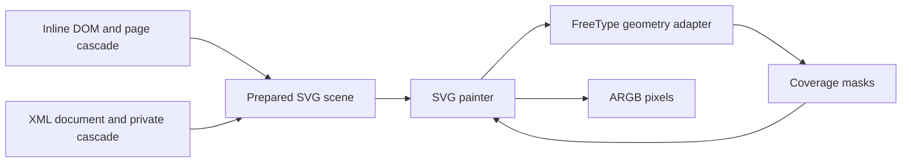

# SVG rendering design

Status: implementation design, 2026-10-25. Quinn, building on Fable's
2026-10-21 SVG proposal. Source baseline: `userland` at `d922229c`.
This is the revised slice 6 design for [MODERN_WEB.md](MODERN_WEB.md).
The stages below are proposed implementation cuts, not completed features.
Quinn owns slice 6. The disposition of Fable's review is in
[SVG_REVIEW.md](SVG_REVIEW.md#quinns-disposition).

## Decision and scope

Build a C `libsvg` that interprets SVG geometry and paints through the
existing FreeType port. Yonder owns its DOM, CSS cascade, loading policy,
layout, events and frame scheduling. FreeType supplies outline coverage
and stroke construction; it does not parse SVG or implement its rendering
model. The FreeType choice and separate renderer originate in Fable's design.

Deliver static rendering first, for both inline SVG and external SVG images.
Keep geometry, document identity and rendering dependencies available so
DOM changes, hit testing and animation can use the same renderer. Static
support is a milestone, not a claim of complete SVG compatibility. Build
against standards and reference tests; use real pages as acceptance cases.

The implementation must prove the geometry adapter before freezing its ABI.
The [private geometry proof](SVG_GEOMETRY.md) records the first fixture,
precision and allocation results. The [production adapter](SVG_GEOMETRY_BACKEND.md)
and [comparison harness](SVG_REFTESTS.md) record their implemented contracts,
measured limits and remaining gates. The first [6b core increment](SVG_CORE.md)
adds reusable paths and group/path scene preparation. The
[solid painter](SVG_PAINT.md) adds fills, ordinary strokes and isolated opacity;
the [Yonder connection](SVG_YONDER.md) paints a bounded inline path/group/basic-shape/use profile;
[SVG_SHAPES.md](SVG_SHAPES.md) records the geometry increment and
[SVG_STROKES.md](SVG_STROKES.md) adds dash patterns, offsets and exact zero-length caps.
[SVG_INSTANCES.md](SVG_INSTANCES.md) adds bounded fragment reuse with instance ancestry.
[SVG_VIEWPORTS.md](SVG_VIEWPORTS.md) adds symbol/nested viewport sizing and rectangular clips.
[SVG_CLIPS.md](SVG_CLIPS.md) adds one-silhouette clip resources and ancestor intersections.
[SVG_BOUNDS.md](SVG_BOUNDS.md) adds geometric bounds and object-coordinate clips,
with shared-consumer boundaries for gradients and Canvas 2D through 6c.
[SVG_DOCUMENTS.md](SVG_DOCUMENTS.md) adds independently owned XML image documents,
isolated embedded styles and secure-static rendering. [SVG_IMAGES.md](SVG_IMAGES.md)
connects picture jobs, default object sizing, `` and background painting.
[SVG_GRADIENTS.md](SVG_GRADIENTS.md) adds linear paint servers and a numeric
sampler shared with future non-markup callers.
This design does not establish
performance or compatibility percentages.

## Library boundaries

| Component | Responsibility |
|---|---|
| `libhtml` and its document adapters | Inline SVG nodes, namespaced attributes, document identity, mutation and lifetime |
| `libxml` | Standalone XML byte-to-event parser; `libhtml` consumes its events to build the shared tree |
| `libgarb` | Selectors, presentation attributes, cascade and SVG computed styles |
| `libflow` | The outer SVG's participation in CSS layout and sizing negotiation |
| `libsvg` | SVG scene construction, paths, viewports, instances, paint servers, clipping and compositing |
| FreeType port | Outline rasterization, stroke expansion and later glyph-outline export |
| `libimage` | Raster decoding and its existing owned pixel representation |
| Yonder | Fetching, processing mode, style/text providers, caches, work scheduling, diagnostics and display |

SVG belongs in its own library. Its inputs include a viewport and document
state, and its result can change without new encoded bytes. Do not make
`os64_image_decode()` silently choose an arbitrary viewport or pull the CSS
engine into raster-only consumers. A future size-aware image convenience
API may delegate to `libsvg` at the application/adapter layer.

The initial public SVG header uses opaque scene/document handles, explicit
size and budget types, and provider callbacks. Keep `flow_family_list_t`,
FreeType structs and the browser's window types out of that header. The
Yonder adapter translates its font/style types. Tree and style providers
must support inline nodes and an XML-parsed document without serializing
inline SVG into a second text document on each render.

Proposed data flow:

A prepared scene records stable source identities, instance identities,
transforms, bounds, drawing order and resource dependencies. It is owned by
the SVG context. It may borrow pinned document data while its owner keeps
the document alive; pins protect lifetime, not concurrent mutation. Preparing
and consuming a scene requires a stable document/style snapshot or owner-thread
serialization. The first implementation prepares resolved scene values for
each paint-cache lookup. Keep parsed paths separately reusable when their inputs
match; memoizing prepared scenes requires the dependency validity described
under Caching.

## Current integration points

The baseline already has SVG namespace/name adjustment in `libhtml`.
`userland/libflow/style.c` treats non-HTML elements as `display: contents`,
and `boxes.c` suppresses their text as prose. `libgarb` still needs the SVG
paint properties and presentation-attribute handling. These are integration
changes, not behavior obtained by linking a rasterizer.

`flow_env_t.replaced_size` currently returns a pair of integer dimensions.
SVG requires independent optional width, height and aspect ratio. Replace the
pair with one intrinsic-size result carrying `has_width`, `has_height`,
`has_ratio` and their values. Raster callers supply all three with ratio derived
from dimensions. Update the shared oracle and host fakes instead of adding a
second SVG-specific oracle. Resolve used sizes in layout, then pass the resulting
viewport to SVG.

The outer SVG forms an atomic graphics box in HTML layout; SVG descendants
belong to the SVG renderer. Detect an SVG viewport root by namespace and
local name, including a standalone document root. Do not classify every SVG
element with an HTML parent as a viewport. Do not apply `` sizing or
`object-fit` rules indiscriminately to inline `<svg>`. Inner SVG establishes
its own viewport. HTML under `foreignObject` is an explicit later integration,
not accidental text leaking through `display: contents`.

`userland/apps/yonder/picture.h` needs a tagged picture product: raster,
raster sequence, or SVG document. The SVG product owns its document, private
cascade, prepared scene and cache references. Teardown releases dependent
scenes/cascades before their document. `picture.c`, the replaced-size oracle,
the painter and diagnostics must agree on this tag.

## Pixel ownership and compositing

`os64_image_t.pixels` is allocated with `os64_malloc` and released through
`os64_image_free`. Returning an arbitrary callback allocation in that struct
would violate its existing contract.

Use a caller-owned render destination: width, height, stride, byte capacity
and straight-alpha ARGB pixels. Validate dimensions, multiplication and row
bounds before writing. Yonder allocates an `os64_image_t` with its normal
allocator and gives SVG a borrowed view. Other hosts can supply their own
storage. On rendering failure the destination is unspecified and must not
be published; a caller preserves its old cached image until a replacement
render succeeds. The renderer never frees a borrowed destination.

Work internally with premultiplied color and explicit coverage. Convert to
straight-alpha ARGB at the export boundary, with RGB zero when alpha is zero.
Distinguish paint interpolation color space from alpha representation.
Gradients implement their required interpolation rules rather than borrowing
CSS-gradient code solely because it also produces colored pixels.

Render an element's fill and stroke in paint order. Apply fill/stroke opacity
to the respective operation, then element/group opacity to the composed
result. An overlapping pair of opaque children in a half-opacity group must
not darken at their overlap. Use bounded offscreen layers or equivalent
semantics; attach effects to the retained group, not just its leaves.
The SVG rendering model defines this distinction. [Rendering model](https://www.w3.org/TR/SVG2/render.html)

## FreeType geometry contract

The imported FreeType version is 2.14.3 (`tools/import_freetype.py`). Its
smooth rasterizer and stroker are in `userland/libfreetype/sources.mk`.
The [production geometry backend](SVG_GEOMETRY_BACKEND.md) implements a
separately versioned table exported by `libfreetype`, with an Os64 header and
opaque context/outline handles. The font backend v1 table and getter are
unchanged. A dedicated geometry context allocates through caller
hooks and has no independent admission cap. The SVG owner's ledger charges
those allocations; geometry live/peak-byte counters are reporting subdivisions,
not a second cap or a second charge. Font engines retain their existing budgets.
This separates font consumers from graphics ABI
growth without importing another copy of FreeType.

The geometry operations are:

| Operation | Contract |
|---|---|
| Create/destroy context | Caller allocator; SVG owner enforces the shared cap; no font face required; caller serializes one context |
| Expand stroke | Validated path, width/caps/joins/miter and precision request to an owned filled outline |
| Rasterize fill | Validated outline, fill rule, affine transform and device clip to caller-owned 8-bit coverage |
| Release outline | Frees through its originating context; context cannot be destroyed with live outlines |

Path input is a bounded stream of move, line, quadratic, cubic and close
commands with finite double coordinates. A move starts a subpath; close
records closure explicitly. End-of-input does not close a stroke. Fill may
implicitly close an open subpath without changing the stored path. Mixed
open and closed contours and dashed pieces cannot be represented by a
single outline-wide `opened` flag.

Feed the stroker by subpath with `FT_Stroker_BeginSubPath`, segment calls
and `FT_Stroker_EndSubPath`; the adapter selects open/closed behavior per
subpath. `FT_Stroker_Set` takes radius, so pass half the SVG stroke width.
Map `miter` to `FT_STROKER_LINEJOIN_MITER_FIXED`, `miter-clip` to
`FT_STROKER_LINEJOIN_MITER_VARIABLE`, and round/bevel to their named modes.
Expose SVG join names at the geometry interface; record a miter fallback for
unsupported `arcs` joins. Pass the miter limit unchanged as a dimensionless
ratio: SVG's miter-length/width and FreeType's spike-length/radius are both
`1 / sin(interior_angle / 2)`. The width is halved for radius; the ratio is not.
Test immediately below, at and above the bevel threshold in 6a, including the
fixed-point rounding boundary. Values below FreeType's minimum ratio require
explicit SVG behavior rather than silently accepting its clamp.
[FreeType stroker](https://freetype.org/freetype2/docs/reference/ft2-glyph_stroker.html)

Ordinary stroke order is: cut dashes in the appropriate user space, expand
the stroke there, transform the resulting filled outline, rasterize.
`scale(4,1)` must stretch a round cap into an ellipse. Transforming a
centerline and stroking it with an averaged width cannot produce that result.
For `non-scaling-stroke`, construct the stroke in the SVG host viewport
space; keep that transform distinct from the final viewport-to-device map.
Exercise dashes, page zoom and device scaling in browser comparisons rather
than assuming that a device-pixel width implements this property.
[SVG stroke and vector effects](https://www.w3.org/TR/SVG2/painting.html#VectorEffects)

Dash measurement uses adaptive curve subdivision with a device-space error
budget. For a nonsingular user-to-device linear map, set geometric flatness
tolerance to device tolerance divided by its largest singular value. Also
bound accumulated arc-length error and dash endpoint error: proximity to a
chord alone does not bound the length of a retracing curve. Handle singular
maps explicitly without dividing by zero. Charge subdivisions and generated
dash segments before work and test large zoom, shear and near-cusp paths.

FreeType's fixed-point coordinates are a backend representation, not the
SVG path storage format. Before conversion, choose a translated/scaled
working coordinate system and account for its inverse in the output map.
Bound rounding error in device pixels and check stroke width, miter growth
and transformed extrema. The proof stage must establish the supported range
and precision; out-of-range geometry returns `LIMIT`, not wrapped integers
or independently clamped control points. No glyph hinting applies to paths.

The imported `FT_Outline` uses unsigned-short counts and contour indices,
with limits declared in `ftimage.h`. Check input and expanded output counts
against the imported limits before narrowing. Do not split a filled path
into independently composited pieces to evade a count limit: that can change
winding, holes and overlap coverage. Allocation and backend errors are returned,
not converted into successful blank pictures.

Coverage requests include a device origin, clip rectangle, stride and storage
capacity. Allocate coverage for clipped ink bounds rather than a full viewport
for each tiny path. Preserve complete shape geometry while clipping its
coverage; clipping a centerline before stroking would introduce false caps.
[FreeType outline processing](https://freetype.org/freetype2/docs/reference/ft2-outline_processing.html)

## Styles and instances

Use the page cascade for inline SVG. External SVG has its own stylesheet
scope and inherited root values; the embedding page's `color` is not an
implicit input to ``. `currentColor` follows the
appropriate document's computed color.

Presentation attributes participate at author origin with specificity zero,
before author stylesheets. Handle SVG names and attributes with their required
case and namespace rules. Store paint values as none, color, or a scoped
resource reference with fallback. Include the supported geometry properties
in the cascade, not just fill and stroke. [SVG styling](https://www.w3.org/TR/SVG2/styling.html)

The winning CSS `transform` replaces the competing presentation-attribute
value through the cascade. Do not multiply both values together. After the
winner is chosen, resolve transform origin/reference box and compose it with
ancestor and viewport transforms. [CSS transforms](https://www.w3.org/TR/css-transforms-1/#svg-transform)

Keep `display` and `visibility` separate. A hidden container can have a visible
descendant; display suppression has different subtree behavior. Definitions
must remain available to references even though their source location does
not paint. `switch` reads `systemLanguage` against the host's preferred language
list (the browser profile), and evaluates `requiredExtensions` against supported
extensions; with none supported a non-empty requirement fails. Empty and absent
attributes follow their specified rules. SVG 2 removed `requiredFeatures` as
a conditional-processing attribute: test and document legacy compatibility
against the pinned WPT/browser behavior rather than inventing a feature table.

`use` produces an instance with its own inherited style and identity. A style
provider keyed only by the referenced source node is insufficient: the same
symbol can inherit red from one instance and blue from another. Pass source
identity, instance ancestry and inherited computed values through scene
construction. References can leave the current SVG subtree while remaining
in the same document. Detect cycles on the active expansion stack, allowing
legitimate repeated references, and cap total expansion as well as depth.
[SVG structure and instances](https://www.w3.org/TR/SVG2/struct.html#UseElement)

## Viewports and paint resources

Track CSS layout size, SVG user space, host viewport and device pixels
separately. `viewBox` and `preserveAspectRatio` establish the mapping inside
the used viewport. Support alignment, meet/slice/none and nested viewports.
Intrinsic dimensions are independent optionals; percentage/auto dimensions
do not invent a natural size. Ratio precedence includes definite width/height,
not just `viewBox`. Apply the CSS default sizing algorithm rather than using
300 by 150 for every missing-size combination. [SVG coordinates and sizing](https://www.w3.org/TR/SVG2/coords.html#IntrinsicSizing)

In a definite-width normal HTML container, the common inline
`<svg viewBox="0 0 200 100">` with auto dimensions should take the available
width and derive height from its ratio. Cover that case explicitly. Do not
generalize it to no-viewBox SVG, shrink-to-fit, flex/grid, constrained heights,
or ``: used dimensions still come from the applicable CSS sizing context.
An `` also has a containing block; its external SVG supplies intrinsic
information, not an instruction to fill that block. Pin contextual expectations
with sizing reftests. [SVG integration sizing](https://svgwg.org/specs/integration/#svg-css-sizing)

Store geometric bounds separately from stroke/paint bounds. Object-bounding-box
paint resources use the required geometric bounds, not the clipped pixel
rectangle. Evaluate gradient coordinates through the correct inverse mapping;
include focal radial gradients, stops, spread modes and reference inheritance.
Cycle handling and work limits apply to paint-server chains as well as `use`.

For clipping, honor each child's clip rule, combine children as a union, and
intersect nested clipping operations. Treat antialias coverage combination as
a tested rasterization choice: adding child alpha blindly is not a geometric
union. Apply viewport overflow clipping at its own boundary. [CSS clipping](https://www.w3.org/TR/css-masking-1/#clipping-paths)

## External documents and processing modes

Inline SVG uses the HTML parser's foreign-content rules. External SVG bytes
use a namespace-aware XML parser, with XML case, encoding and well-formedness
rules. Content type plus successful root recognition selects the decoder;
`<?xml` alone does not identify SVG. Keep XML failures distinct from HTML
error recovery. An external XML stylesheet scope must not depend on inventing
HTML `html`, `head` and `body` elements.

Build an in-house `libxml` as a bounded push parser. Its output is namespace-
resolved start/end-element events, attributes, text, CDATA, comments, processing
instructions and encoding information. It has no public node type, no document
tree and no I/O. Allocator callbacks carry the caller's context. `libhtml`
consumes the events to build its existing node type; other consumers may build
their own products. [XML.md](XML.md) defines this reusable boundary and profile.

Decode UTF-8 and UTF-16 in the parser. Report other declared encodings explicitly
so a host can transcode and restart coherently; do not parse transcoded UTF-8
under a stale UTF-16 declaration. Bound input, token storage, attributes,
nesting, namespace bindings, expansion and work. Accept predefined/numeric
references and bounded internal general entities with literal text values,
including Illustrator-style namespace declarations. External entities,
parameter entities and validation remain unsupported. The entity profile must
distinguish malformed input from unsupported legal XML.

Reuse the existing SVG-root capability: `libdom/implementation.c` creates a
document whose direct child is SVG and marks its wrapper `D_DOCUMENT_SVG`.
No HTML wrappers are needed. 6a must prove byte-to-tree building, independently
owned document lifetime and cascade traversal for a non-HTML root, `:root`,
inheritance and SVG `<style>`. A secondary document in a page-owned arena is
evidence of structural support, not a completed independent image loader.

Keep the namespace enum concern narrow: the known SVG root is representable,
but generic XML elements in no namespace or arbitrary namespace URIs are not.
`createDocument` explicitly refuses those. RSS, Atom and foreign SVG metadata
provide concrete consumers; attribute namespace URI storage does not solve
element namespace identity. Preserve URI/local-name identity in parser events
and extend the shared tree representation where the XML builder needs it.
Never reinterpret an unknown namespace as SVG. This does not block inline SVG.

Processing mode is an explicit scene input. Inline content follows the page's
permissions. Images embedded through `` or CSS use an isolated image mode:
no script execution, interaction or external network/file resource fetches
from that image document. Support permitted embedded data resources within
their own budgets. Time-based animation is a later image-mode feature, not
permission to enable script. Top-level SVG navigation and `<object>` need
their own document integration and are outside the initial picture path.
[SVG processing modes](https://www.w3.org/TR/SVG2/conform.html#processing-modes)

The renderer performs no I/O. Later `<image>`, external references and fonts
use the host's asynchronous resolver subject to processing mode and the
browser's origin/resource policies. A completed resource changes the resolved
scene values and invalidates any preparation memo. Decode embedded raster content
through the existing image codecs rather than importing duplicate decoders.

## Budgets and scheduling

Proposed initial host defaults, to be measured in 6a/6c:

| Limit | Initial value or rule |
|---|---|
| Encoded input | Existing `OS64_IMAGE_CAP_DEFAULT` |
| Per-SVG admission budget | 64 MiB including owned document/cascade/scene, render scratch, geometry-engine allocations and destination |
| Destination pixels | At most 8,388,608, and each axis within `OS64_IMAGE_DIM_MAX`; checked before allocation |
| Element depth | 128 |
| Active reference depth | 32 |
| Source nodes / expanded instances | 100,000 / 100,000, separately charged |
| Path commands per source path | 32,768, additionally constrained by backend conversion/output limits |
| Dash entries | 1,024; validate signs, odd duplication and zero-total behavior |
| Geometry work | 1,000,000 charged subdivision/dash/expansion operations per preparation |
| Raster work | 64,000,000 covered bounding-box pixel visits per render, including scratch layers |

These values are policy defaults, not compatibility guarantees. Hosts may
lower them. Raising them needs measurement against responsiveness and memory.
Account shared document storage once under its owner; still admit SVG scratch
and output against the page/work-pool budget. Peak accounting includes the old
cached result while building its replacement. The 64 MiB limit is not a
promise that the largest permitted destination leaves room for every scene.

Charge before allocations and costly expansion, including dashed output,
arc subdivision and temporary copies. FreeType allocation uses the same
admission ledger. Acyclic reference doubling can exhaust work without reaching
a depth limit. Very small dash intervals can do the same. Invalid arithmetic,
allocation refusal, work exhaustion and cancellation have distinct outcomes.

Large rasters fail with `LIMIT` in the first implementation. Any later
reduced-resolution rendering must be an explicit host policy with preserved
aspect ratio and a reported scale, not silent independent axis clamping.

Parse external bytes on a worker. Initial scene preparation and bounded small
renders run on the document-owning thread, with no blocking fetch. Poll
cancellation between bounded work units and ensure a backend call has bounded
input; a memory cap alone is not a time limit. Measure worst-case call latency
on the P5 before accepting UI-thread rendering. If that budget is exceeded,
move raster work to workers using immutable prepared scenes and private
geometry engines. Do not send live DOM/cascade pointers to workers.

## Caching and animation

Cache raster results by resolved scene value, following the painter's existing
gradient/shadow cache. Canonical keys include drawing order, geometry, resolved
paint/effect values, viewport, scale, fractional device origin, relevant
dark-pages state and processing mode. Resource content and, later, positioned
glyph outlines are value inputs too. Source node and document identities are
not pixel-cache keys, so identical icons can share one result.

A digest finds candidates; compare canonical values before reusing pixels.
Force a digest collision in tests. Serialize explicit fields with finite-number
validation and defined zero handling, not struct padding or pointer values.
Cache storage owns its value key and pixels, independently of DOM lifetime.
Prepared scenes may still hold document pins; pixel deduplication does not
deduplicate event targets or instance identities.

Initially prepare the resolved scene before lookup. That naturally incorporates
fresh stylesheet/font/resource values without invented generation APIs. Measure
the walk separately from raster time; it is not assumed cheap. Future preparation
memos must be invalidated by changes to document, external definitions, cascade,
font selection, resources, language, viewport and animation sampling. Document
version alone is not sufficient. Do not cache a transient failure as permanent,
or serve old pixels under a new value key. Repeated unchanged paints should
avoid rasterization; avoiding preparation is a later measured optimization.

Animation is a subsequent consumer of this model. CSS timelines and script
mutations produce sampled styles/geometry; those invalidate the relevant
scene and pixels. Schedule through the browser frame loop and coalesce changes.
Image-mode timelines have no script callbacks. SMIL, SVG DOM geometry methods,
hit testing and event retargeting are explicit features, not side effects of
having a cascade. Retaining instances and transforms makes them possible;
it does not claim they have been implemented.

## Implementation stages

| Stage | Deliverable | Exit evidence |
|---|---|---|
| 6a foundations | Reftest comparison; FreeType geometry proof; standalone event-based `libxml` with xmlconf harness; shared tree/cascade proof; budget accounting | Reference/mismatch runner self-tests; mixed open/closed paths; miter thresholds; unequal transforms; precision/overflow limits; xmlconf profile results and per-parser allocation-failure isolation |
| 6b static inline core | Scene/provider contracts; SVG styles and sizing; shapes and complete path grammar; transforms; solid fills/strokes/dashes; `use`/`symbol`; nested viewports; clipping; opacity groups | Focused WPT tests and browser reference fixtures; mutation/recolor and repeated-symbol tests; failure sweeps |
| 6c static image route and gradients | XML adapter; isolated external-image cascade; tagged picture jobs; intrinsic sizing; gradient servers; caches and resource-mode enforcement | Same artwork inline and in ``; CSS-scope separation; XML/namespace cases; resource-policy tests; P5 latency/memory/corpus results |
| 6d broader static graphics | Shared text shaping and glyph-outline export; text positioning and transforms; markers, embedded images, patterns, masks and selected filters in separate subcuts | Feature-specific WPT/reference suites, font fallback/complex-text cases, color-space and filter bounds tests |
| 6e interaction and motion | Hit testing, SVG DOM geometry, CSS animation/transition sampling, frame-loop integration; separately scoped SMIL support | Deterministic timestamp frames, mutation/reference propagation, event targeting, image-mode restrictions and frame-time measurements |

Schedule 6a–6c. 6a can start without relayout or animation. The geometry proof
and comparison harness precede 6b; XML work can proceed independently and is
needed for 6c. 6b also needs the cascade properties and intrinsic-size oracle,
but does not wait for XML parsing. 6d and 6e remain planned follow-on coverage,
with their start and priorities chosen from real needs; listing them does not
claim they are part of the initial delivery. 6e needs the browser's
frame/mutation infrastructure. Do not declare broad modern-web SVG support
after 6b merely because a set of icons renders.

Text must share Yonder's font selection and shaping. FreeType rasterizes or
exports glyph outlines; it is not the shaping engine. A bitmap-only text
provider is insufficient for stroked, rotated or sheared text. Define an
outline/positioned-glyph contract in 6d and test the text layout features
actually promised. Partial text support must be named in the capability list.

## Verification and diagnostics

Use exact tests for parsing, coordinate maps, closure, ownership, statuses,
resource decisions and invalidation. Compare pictures for coverage, joins,
gradients, clipping and opacity. Import relevant WPT SVG/CSS reftests and honor
their match/mismatch and fuzzy metadata. Record the supported feature set and
expected failures by feature, rather than deleting failing cases from the tally.

Browser-generated reference images supplement WPT with real icons and crafted
edge cases. Record browser version, viewport, device scale and fonts. Establish
per-fixture tolerances; do not exempt every pixel near an edge, which can make
a thin icon disappear without failing its comparison. Include negative controls
that lose a stroke, reverse winding, misapply a transform or multiply group
opacity per child. Compare translucent results over both light and dark grounds.

Mandatory difficult cases include zero-length paths and dashes, closed-path
dash seams, sharp miters, arcs at extreme scales, degenerate/singular transforms,
reused symbols with different colors, shared definitions outside the root,
gradient/reference cycles, hidden parents with visible children, a CSS transform
overriding an attribute, and a font/resource arriving after first paint.

Sweep allocations in the SVG layer, parser bridge and geometry adapter. Run
ASan/UBSan with leak detection; sanitizer verification includes an explicit
leak verdict. The slice brief carries environment-specific execution guidance.
Fuzz parsers and geometry with bounded work and cancellation. The XML conformance
report distinguishes supported passes/failures from unsupported-profile cases;
rejecting a valid out-of-profile file is not a conformance pass.

Keep `UNSUPPORTED`, malformed input, `LIMIT`, allocation failure, pending resource
and cancellation separate. Optional-feature omission reports a diagnostic and
partial capability; it must not masquerade as fully supported SVG. Legal invalid
elements follow the specification's local error behavior; a resource-budget
failure aborts the unpublished result. Count scene builds, rasterizations,
cache hits, peak bytes, work-limit refusals and elapsed time.

## Alternatives and reasons

| Option | Decision |
|---|---|
| FreeType-backed native SVG | Selected. Reuses the port's allocation model and geometry facilities while keeping browser semantics in the browser stack. Geometry precision and performance remain proof-stage gates. |
| NanoSVG | Not the browser foundation. Upstream describes a small icon/prototyping library and says it is not actively maintained. [Upstream](https://github.com/memononen/nanosvg/blob/master/README.md) |
| PlutoSVG | A C candidate focused on SVG fonts/icons; useful comparative material, not evidence of full browser integration. [Upstream](https://github.com/sammycage/plutosvg/blob/master/README.md) |
| PlutoVG | A plausible C vector backend. Source inspection found a scalar approximation for transformed stroke width and unchecked allocation use in rasterization; adoption requires adaptation and testing, and imports FreeType-derived geometry code alongside our existing port. [Rasterizer](https://github.com/sammycage/plutovg/blob/main/source/plutovg-rasterize.c) |
| LunaSVG | Reconsider when a C++ userland toolchain/runtime port is wanted. A language runtime port is distinct from kernel awareness of that language. [Upstream](https://github.com/sammycage/lunasvg/blob/master/README.md) |
| resvg | Retain as a potential static-image alternative and test reference. Its usvg parser uses `std` without a `no_std` configuration; dependency adaptation/standard-library support requires a port study. Rust itself can use an OS allocator and C ABI without a Rust-aware kernel. This design makes no estimate of that port's difficulty. [usvg](https://github.com/linebender/resvg/blob/main/crates/usvg/src/lib.rs), [features](https://github.com/linebender/resvg/blob/main/crates/usvg/Cargo.toml) |

The library observations are source-level evidence accessed 2026-10-25, not
measured performance or a complete audit. If 6a shows that precision, port
maintenance or responsiveness make the selected backend unattractive, compare
alternatives against the same fixtures before expanding implementation scope.

## Related design and implementation references

- [Modern Web campaign](MODERN_WEB.md) and [slice briefs](MODERN_WEB_BRIEFS.md).
- [Font contracts](../completed/FONT_CONTRACTS.md) and [font provider](../completed/FONT_PROVIDER.md).
- [Image ownership](../../../userland/libimage/include/image/image.h),
  [font backend](../../../userland/libos64/include/os64/font_backend.h),
  [FreeType build list](../../../userland/libfreetype/sources.mk),
  [document API](../../../userland/libhtml/include/html/html.h).
- Fable's original proposal is preserved in Git at
  `6588854f:docs/design/pending/SVG.md` on `fable/modern-web`.
  This revision keeps its architecture while replacing the single
  device-outline stroke verb, HTML parsing of SVG files, and static cache
  assumptions with the contracts above.
